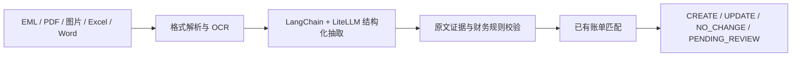

# Shipping Billing Assistant

面向航运及国际货代场景的 AI 账单理解与对账助手。它把 EML、PDF、图片、Excel 和 Word 中分散的费用事实，转换为逐费用项、可校验、可追溯的 JSON 决策，并根据已有账单判断 `CREATE`、`UPDATE`、`NO_CHANGE` 或 `PENDING_REVIEW`。

项目不让 LLM 直接“算账”：语义理解限制在抽取环节，标准化、校验、匹配、字段继承和 AR/AP 判定由可测试的确定性规则完成。费用证据不在原文、币种或方向不明时，系统宁可待复核也不虚构财务事实。

当前已完成核心业务闭环、LangChain + LiteLLM 接入、可配置 OCR 接入、七牛临时文件桥接、Streamlit 演示页与 GitHub Actions CI。

## 系统架构



语言模型只负责语义抽取；证据归属、标准化、金额校验、账单匹配和操作决策继续由确定性代码完成。模型服务通过 LiteLLM 配置，可按部署环境替换兼容的模型端点，不影响领域规则。

## 两分钟理解处理流程

```text
本地文件 / 已有账单 JSON / 当前记账主体
  → EML/Excel/Word/PDF/图片解析
  → PDF/图片临时上传并调用已配置的 OCR 服务
  → LangChain + LiteLLM 抽取事实和逐字证据
  → 确定性标准化、校验和重复检测
  → 四级已有账单匹配、操作决策与 AR/AP 判定
  → 每个费用项一条合法 JSON
```

## 实现要点

- EML 会解析邮件头、正文和附件，附件递归交给同一格式调度器。
- PDF/图片调用可配置 OCR 服务；有文本层的 PDF 同时补充本地文本。
- 费用名称、币种和 PP/CC 会标准化，原始费用名仍保留。
- 模型证据必须是所标注来源文件中的连续原文；内部层级 `source_id` 可区分同名上传文件或同名附件，不能借用同批其他文件的文本通过校验。
- 首次结构化结果为空但原始正文或表格中存在明确金额候选时，仅进行一次保守语义复核：首次已有唯一单据时只合并复核费用并保留原上下文；首次为空信封时仅接受复核得到的唯一单据；多单据歧义时不合并。复核不得把条件费率、无金额运输条款或常识猜测当作实际费用。
- 更新只改变材料明确指定、带逐字段原文新值且与候选值一致的字段；重复、冲突、低置信度或 AR/AP 无法确定时待复核。
- Streamlit 展示输入、处理阶段、最终 JSON 和下载入口。

## 设计边界

这是一个模块化 Python 应用，不是微服务系统。Streamlit 复用同一应用用例；已有账单以输入 JSON 提供；七牛只是 OCR 的短期文件桥接。当前范围不建数据库、消息队列、缓存、向量库、工作流引擎或多 Agent 编排。

```text
src/      按 DDD 与六边形边界组织的核心实现
tests/    单元测试、集成测试和完全合成的公开样本
demo/     Streamlit 演示页
docs/     架构、范围、验收、样本评估与设计思考
```

## 运行

要求 Python 3.11+，推荐使用 uv。

Linux/macOS（Bash）：

```bash
uv sync --all-extras --frozen
# 仅首次运行且 .env 尚不存在时执行
cp .env.example .env
# 编辑 .env：至少填写 LITELLM_API_KEY 和 OCR_ENDPOINT
# 处理 PDF/图片还需七牛的四项 QINIU_* 配置
uv run streamlit run demo/app.py
```

Windows PowerShell 首次创建配置文件：

```powershell
Copy-Item .env.example .env
```

`.env` 已被 Git 忽略，应用启动时自动读取；操作系统已设置的同名环境变量优先。模型名遵循 LiteLLM `provider/model` 约定，使用兼容端点时可设置 `LITELLM_API_BASE`；`LITELLM_TIMEOUT_SECONDS` 默认 120 秒，避免模型调用无限等待。

浏览器中只需在同一控件上传业务文件，填写当前记账主体，并仅在判断更新/无变化时上传已有账单 JSON。PDF、图片和 EML 内 OCR 附件由后端自动临时托管，用户无需填写 URL。

## 增强演示界面

Streamlit 页面除最终 JSON 外，还会展示费用项数量、自动决策数量、待复核数量、涉及币种、逐费用项结果表以及可展开的证据与决策轨迹。侧栏提供完全合成的新建、更新和待复核样本，可直接下载后上传演示。

为控制公开服务资源，单次请求最多上传 8 个文件，单文件不超过 10 MB，所有文件合计不超过 25 MB。超过限制的请求会在调用 OCR 或模型服务之前被拒绝。

## Docker 运行

构建镜像：

```bash
docker build -t shipping-billing-assistant .
```

使用本地 `.env` 启动服务：

```bash
docker run --rm -p 8501:8501 --env-file .env shipping-billing-assistant
```

容器监听 `8501` 端口，并通过 Streamlit 的 `/_stcore/health` 路径提供健康检查。公开部署时应只使用服务端注入的凭据，为外部 OCR、模型和临时存储设置严格配额，不在镜像、仓库或浏览器端暴露密钥；公开示例应继续使用仓库提供的合成材料。

`OCR_ENDPOINT` 需要指向与当前适配器协议兼容的 HTTP 服务，并非任意 OCR 产品地址。请求体固定为：

```json
{"file": "<短期可下载 URL>", "task": "orderChange", "callBack": "", "taskType": ""}
```

响应必须是 JSON 对象：可以在任意层级通过 `text`、`content`、`markdown` 或 `ocr_text` 返回文本，也可以通过 `table`、`tables` 或 `rows` 返回二维数组；若顶层 `data` 是非空对象或数组，应用会把其中内容作为结构化文本。当 `data` 是对象时，会过滤其顶层任务创建时间、文件名和分页等运行元数据。协议不兼容时需要实现新的 `OcrPort` 适配器。

## 外部服务与日志

- `QINIU_DOMAIN` 必须是 Bucket 下载域名，不能是七牛控制台地址。新 Bucket 的测试域名通常只有 30 天有效期。
- OCR 对 502/503/504 和连接异常最多尝试三次；页面只显示友好提示，技术细节保留在终端。
- 默认 `INFO` 日志展示处理阶段、解析器、LLM、OCR 和临时文件清理；可设 `LOG_LEVEL=DEBUG`。日志不记录文件正文、密钥或完整签名 URL。OCR 已成功但临时对象清理失败时会记录异常并保留识别结果。
- 旧版 `.doc` 需要本机安装 LibreOffice 并可执行 `soffice`；`.docx` 不需要。

## 如何解读 `null` 和 `PENDING_REVIEW`

- `null` 不等于程序漏填。原文未出现、OCR 未返回或业务含义无法确定时，系统按保守策略不猜测。
- `PENDING_REVIEW` 是财务安全结果，不是系统异常。缺金额/币种、证据不落在原文、确认来自同一来源行的重复、匹配冲突、低置信度或无法判断 AR/AP 都会触发它；来源位置不同或无法精确定位的同值费用逐行保留并告警。
- 图片中肉眼可见但 OCR 响应缺失的值不能由项目猜测补齐；这是外部输入能力边界，而非字段映射错误。
- 四个合成样本的人工基线、验证重点和预期行为见 [样本效果评估](docs/sample-evaluation.md)。

## 质量检查

```bash
uv run ruff format --check .
uv run ruff check .
uv run mypy
uv run pytest
```

相同检查已配置在 `.github/workflows/ci.yml`，覆盖率门槛为 80%。外部 OCR/LLM 的实时效果因服务和模型版本可变，不放入 CI；四个公开合成样本用于解析回归，并通过人工基线文档说明预期行为。

## 样本数据与许可证

`tests/fixtures/documents` 中的企业、联系人、邮箱、单据号、提单号、箱号和金额均为合成数据，不对应真实客户或交易。样本可通过 `tests/fixtures/generate_synthetic_documents.py` 重新生成。项目代码采用 [MIT License](LICENSE)。

## 文档

- [系统架构](docs/architecture.md)
- [实现目标与边界](docs/implementation-goals.md)
- [验收标准对照表](docs/acceptance-criteria.md)
- [合成样本评估基线](docs/sample-evaluation.md)
- [业务与技术思考](docs/design-considerations.md)
