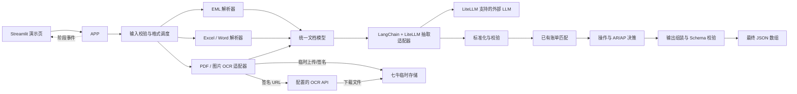

# 系统架构

## 1. 架构结论

系统采用单仓库、单 Python 应用、模块化分层架构。

运行时仅包含：

- 核心业务应用；
- Streamlit 演示页面；
- 外部大语言模型接口；
- 可配置的外部 OCR API；
- 用于 OCR 临时下载的七牛云 Kodo。

Streamlit 不是独立业务服务，只是核心应用的 UI 适配器。七牛云 Kodo 不保存业务状态，只临时托管 OCR 输入并在调用结束后删除。当前范围不需要数据库、消息队列、Redis、向量数据库、持久化文件中心、工作流引擎或多个 Agent。

## 2. 输入契约

一次处理请求包含：

```text
source_files        一个或多个 EML/PDF/图片/Excel/Word 本地文件
existing_bills      可选的已有账单 JSON；未提供时按空列表处理
accounting_entity   当前记账主体；用于 AR/AP 判断
```

应用把当前记账主体作为显式输入，用于判断 AR/AP；如果无法获得，则不猜测，相关结果进入 `PENDING_REVIEW`。

当前 OCR 适配器要求 `file` 是可下载地址。应用会把本地 PDF/图片及 EML 中的相关附件临时上传到私有七牛 Bucket，生成短期签名 URL，并在 OCR 返回或失败后删除对象。该技术过程对页面用户透明；测试使用存储和 OCR 替身，不访问外部服务。

## 3. 输出契约

最终输出为 JSON 数组，每个费用项目对应一条记录：

```text
operation
document_info
transaction_party
charge_details
financial_attributes
audit_trail
```

公开输出遵循稳定的最小契约，不增加未经调用方约定的平级扩展字段：

```text
document_info: document_type, reference_no, document_date
transaction_party: issuer, recipient
charge_details: charge_item, amount, currency, payment_term
financial_attributes: accounting_entity, posting_type
audit_trail: ai_reasoning
```

原始费用名、字段证据、解析警告以及单据级小计/税额/总计保留在内部模型中；需要进入最终结果的来源、原文和警告会转换为 `audit_trail.ai_reasoning` 条目，不改变约定 JSON Schema。

`operation` 只能是：

- `CREATE`
- `UPDATE`
- `NO_CHANGE`
- `PENDING_REVIEW`

无法提取的字段使用 `null`，金额使用数字类型，币种使用三位代码。更新时只修改输入材料明确变更的字段，其余字段继承已有账单值。

代码压缩包或 Git 仓库链接属于项目交付物，不属于系统运行时输出。

## 4. 模块与交互



## 5. 核心应用服务

`ProcessBillingDocuments` 是 Streamlit 和测试代码调用的应用用例，对外暴露单一处理方法：

```python
process(request, progress_callback=None) -> tuple[BillingRecordOutput, ...]
```

它只负责编排模块，不实现具体解析或业务规则。`progress_callback` 用于把阶段事件发送给 Streamlit 页面；不提供回调时不影响核心处理。

建议处理阶段：

```text
RECEIVED
PARSING
EXTRACTING
NORMALIZING
VALIDATING
MATCHING
DECIDING
BUILDING_OUTPUT
COMPLETED
```

这些阶段是单次进程内执行状态，不需要持久化工作流引擎。异常由应用错误和 Streamlit 友好提示承接，不伪装成已完成的阶段事件。

## 6. 文档解析层

### 格式调度器

根据文件类型选择解析器，所有解析器实现统一接口并输出 `ParsedDocument`。

### EML 解析器

- 解析主题、发件人、收件人和正文；
- 提取附件；
- 将附件重新交给格式调度器递归处理；
- 保留邮件与附件的父子来源关系。

### PDF/图片 OCR 适配器

- 将本地文件临时上传到私有七牛 Bucket；
- 生成短期签名下载 URL；
- 按运行配置调用 OCR API；
- 对带文本层的 PDF 在本地补充提取原文，与 OCR 结构化结果共同构成统一文档；
- OCR 成功或失败后都尝试删除临时对象；成功结果不会因后续清理失败而丢弃，清理异常写入日志；
- 设置连接和读取超时；
- 校验 HTTP 与响应格式；
- 将 OCR 响应转换为统一文档模型；
- 保留 OCR 原始结果用于处理依据。

OCR 响应中的任务创建时间、分页信息等运行元数据不会作为单据事实传给 LLM。扫描 PDF 和图片没有可用文本层时，系统只使用 OCR 返回的业务字段；关键字段缺失时进入待复核，而不是根据文件类型或金额格式猜测。

### Excel 解析器

- 遍历工作表；
- 提取单元格、表头和费用明细行；
- 保留工作表名及行号。

### Word 解析器

- 提取正文段落和表格；
- 保留段落与表格顺序；
- 保留来源位置。

## 7. 统一文档模型

统一模型屏蔽输入格式差异，至少包含：

```text
source                    文件与附件来源
source_id                 本次请求内唯一的层级来源标识
email_metadata            可选邮件头信息
text_blocks               文本块及位置
tables                    表格、表头和行位置
raw_text                  原始解析文本
children                  EML 附件解析结果
warnings                  解析警告
```

后续 LangChain 运行时只处理统一模型，不直接读取原始二进制文件。

## 8. LangChain 与 LiteLLM 抽取适配器

项目只需要一个受控的抽取链，不需要多个自治 Agent。应用层仅依赖 `BillingExtractorPort`；具体适配器使用 `langchain-litellm` 的 `ChatLiteLLM`，因此模型厂商、API Key 和兼容端点都由启动配置决定，不泄漏到领域层。

它负责需要语义理解的任务：

- 单据类型、编号和日期；
- 签发方和接收方；
- 提单号、订舱号和箱号；
- 费用行及其原始名称；
- 数量、单价、金额、币种和付款方式；
- 小计、税额和总计；
- 材料中明确表达的字段变更；
- 字段对应的文本依据。

抽取结果必须使用结构化输出模型。若首次输出结构无效，系统只做一次不增加业务事实的结构修复；若结构合法但所有费用为空，同时原始正文、文本块、元数据或同一表格行中存在货币符号或有效 ISO 4217 币种代码相邻的金额候选，则做一次保守语义复核。首次结果已有唯一单据且复核也唯一时，只合并复核费用并保留首次单据头、交易方、方向和合计等上下文；首次为空信封时，仅接受复核得到的唯一单据；多单据无法建立稳定对应关系时保留首次结果。复核仍要求原文证据，并明确排除条件费率和无金额运输条款。Agent 不负责最终账单写入、金额计算、匹配规则、字段继承或 JSON 合法性判断。

## 9. 领域处理层

### 标准化

- 通过内置费用词典维护常见费用别名映射；
- 同时保留原始名称和标准名称；
- 统一币种、日期和付款方式表达。

### 校验

校验覆盖以下财务安全边界：

- 金额是否为有效数字；
- 币种是否符合三位代码；
- 费用明细金额之和是否等于单据小计，小计加税额是否等于总计；
- 每条费用自己的证据是否存在 `0/O`、`1/I` 等可疑错误；非费用区域的疑似字符仅告警，不扩散为所有费用的阻断错误；
- 同一费用是否来自同一来源行；同名、同金额、同币种但来源行不同的真实费用逐行保留；
- 关键结果是否低置信度。
- 每条费用证据是否为其 `source_id` 与 `source_name` 共同指向的输入文件中的连续原文；层级 `source_id` 用于区分同名顶层文件和同名附件；
- 每个 `explicit_changes` 字段是否具有同字段名、同来源且可落地的逐字变更证据，原文中的新值 token 是否能按金额、日期、币种、付款方式等字段类型归一后与候选值一致。

付款方式只接受费用行语义下的 `PP`/`CC`：费用行 `P/PP/PREPAID` 归一为 `PP`，`C/CC/COLLECT` 归一为 `CC`。`COD`、`NET` 等单据级结算条件不会被误当成费用行付款方式。

### 已有账单匹配

按当前业务契约定义的优先顺序执行：

1. 单据编号和费用名称；
2. 提单号、费用名称和币种；
3. 订舱号、费用名称和币种；
4. 箱号、交易双方、日期和金额。

已有账单直接从请求 JSON 载入内存，不需要数据库。

### 操作决策

```text
有效费用且没有匹配账单         -> CREATE
唯一匹配且存在明确字段变更     -> UPDATE
唯一匹配且没有字段变化         -> NO_CHANGE
多重匹配/冲突/低置信度/缺字段  -> PENDING_REVIEW
```

更新逻辑只合并明确发生变化且有原文证据的字段，其他字段继承原账单。代码先核对证据中的新值与候选值，再将候选新值与已有值比较：证据存在但值相同仍是 `NO_CHANGE`，没有逐字段证据、新值缺失或证据值不一致则进入 `PENDING_REVIEW`。

### AR/AP 判断

结合当前记账主体、签发方、接收方和收费方向判断。不能仅通过 Debit Note 或 Credit Note 推断。证据不足时输出 `null` 并进入 `PENDING_REVIEW`。

交易方比较仅做保守归一：忽略大小写、多余空白和公司名末尾 2–5 位的括号网点代码（例如 `(LAX)`）；不删除 `(HOLDINGS)` 等可能影响法人身份的描述，也不做模糊名称匹配。

## 10. 输出层

- 按费用项目展开记录；
- 组装公开输出契约字段；
- 写入简洁且可核对的处理依据；
- 对最终数组执行 Pydantic/JSON Schema 校验；
- 将结果交给 Streamlit 展示、下载，或返回给直接调用应用用例的 Python 代码。

## 11. Streamlit 演示页面

页面只包含业务演示需要的三个区域。

### 输入

- 在同一个控件中上传本地 EML、PDF、图片、Excel、Word；
- PDF、图片和 EML 内的 OCR 附件由后端自动临时托管；
- 可选上传已有账单 JSON；
- 输入当前记账主体；
- 启动处理。

### 处理流程可视化

展示当前阶段及已完成阶段：

```text
文件识别 → 文档解析/OCR → 信息抽取 → 标准化与校验
        → 账单匹配 → 操作和 AR/AP 判断 → 输出校验
```

可展示每个阶段的成功、警告或失败状态，但不建设后台任务系统或持久化任务中心。

### 最终输出

- 格式化展示最终 JSON；
- 展示校验错误或警告；
- 提供 JSON 下载；
- 可按费用项目查看原始值、标准值和处理依据。

## 12. DDD 与六边形目录结构

```text
src/
├── domain/
│   └── billing/
├── application/
│   ├── dto/
│   ├── ports/
│   │   └── outbound/
│   └── use_cases/
├── adapters/
│   └── outbound/
│       ├── parsers/
│       ├── ocr/
│       ├── storage/
│       └── llm/
└── bootstrap/
```

### `domain`

领域层不依赖 LangChain、Streamlit、OCR SDK 或具体文件解析库。

- `billing`：账单、费用、匹配规则、操作决策、AR/AP 判断、校验规则等领域对象与服务。

### `application`

应用层负责组织业务用例，不包含具体外部技术实现。

- `ports/outbound`：文档解析、OCR、临时文件存储、LLM 等外部能力所需的抽象端口；
- `dto`：统一解析文档、输入请求和最终输出等应用边界模型；
- `use_cases`：账单处理主流程及阶段事件定义。

### `adapters`

适配器层实现应用端口。

- `outbound/parsers`：EML、Excel、Word 等解析器；
- `outbound/ocr`：可配置 OCR API 的客户端；
- `outbound/storage`：七牛临时文件适配器；
- `outbound/llm`：基于 LangChain 的结构化抽取实现。

Streamlit 位于项目根目录的 `demo`，直接调用应用用例，不复制业务规则，也不直接引用具体输出适配器。

### `bootstrap`

负责读取配置、创建具体适配器并组装应用对象。依赖方向始终指向领域层和应用层，领域层不会反向依赖适配器。

## 13. 测试目录

```text
tests/
├── unit/
│   ├── domain/                       # 镜像 src/domain
│   ├── application/                  # 镜像 src/application
│   ├── adapters/                     # 镜像 src/adapters
│   └── bootstrap/                    # 镜像 src/bootstrap
└── integration/                      # 按真实集成点或业务流程扩展
```

单元测试与源代码保持相同的相对目录，使领域规则、应用用例和适配器测试容易定位。集成测试不机械镜像源码，而是按实际集成对象组织，例如文档解析、OCR API、LLM 结构化输出或完整账单处理流程。
